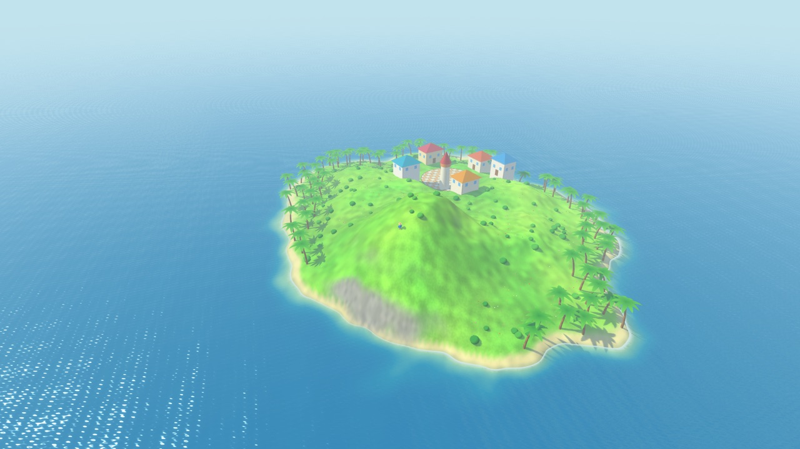
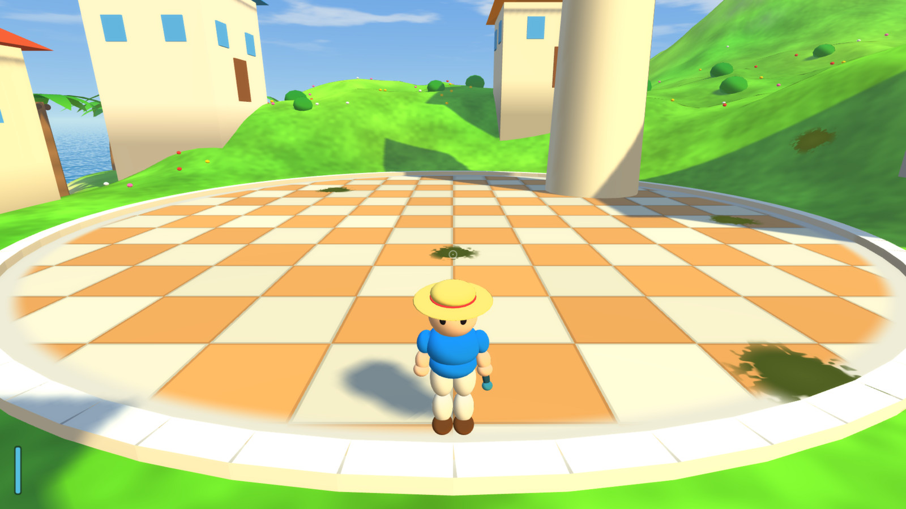
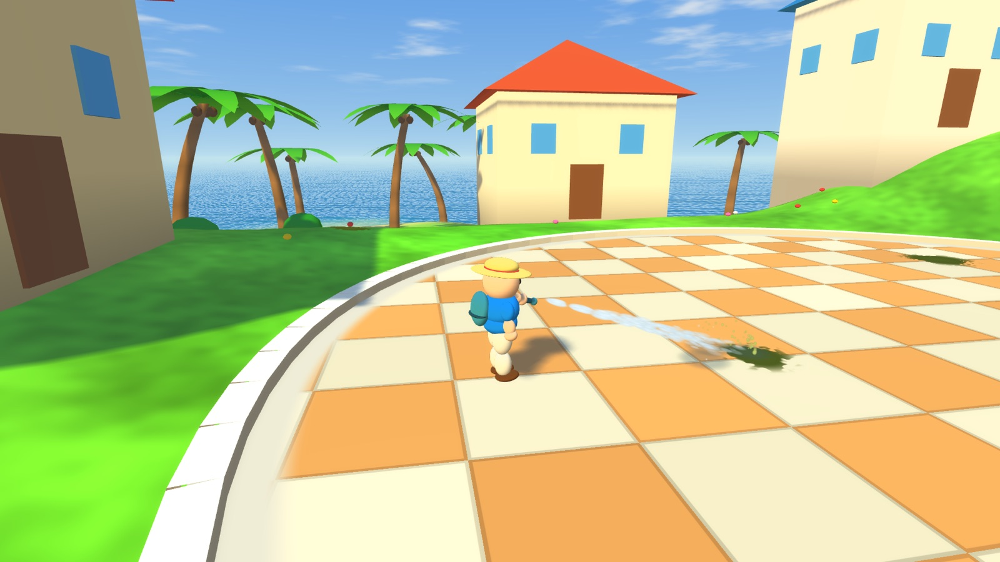
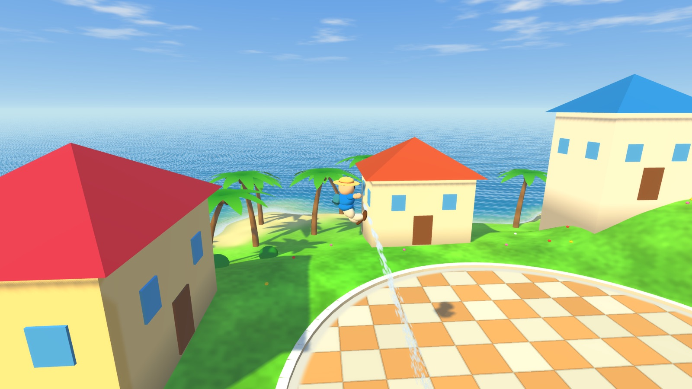
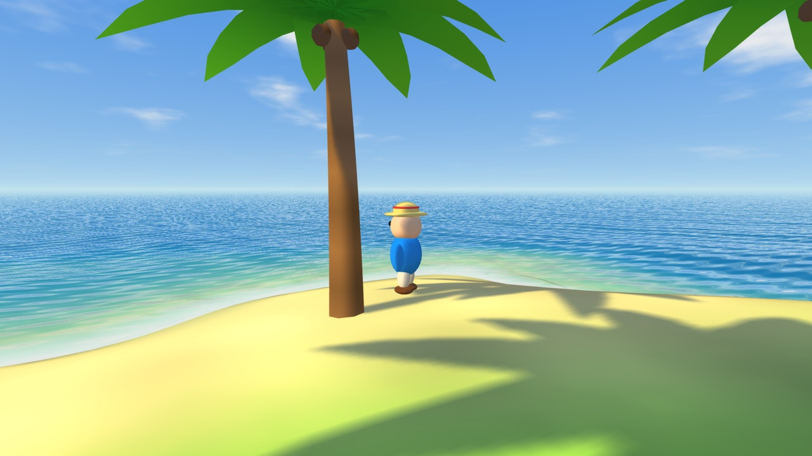
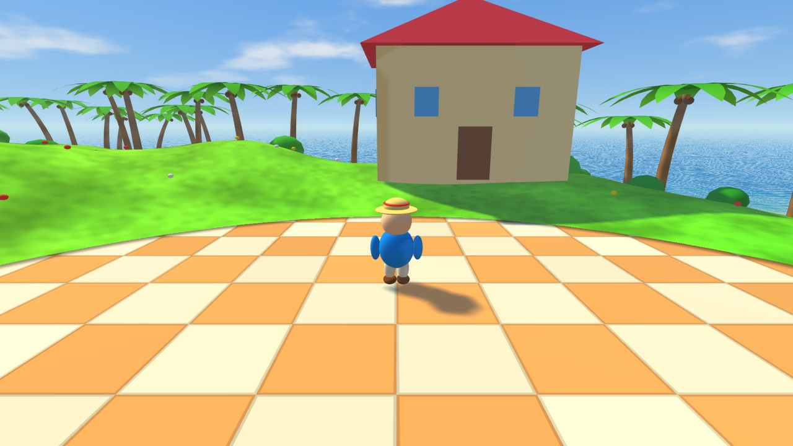
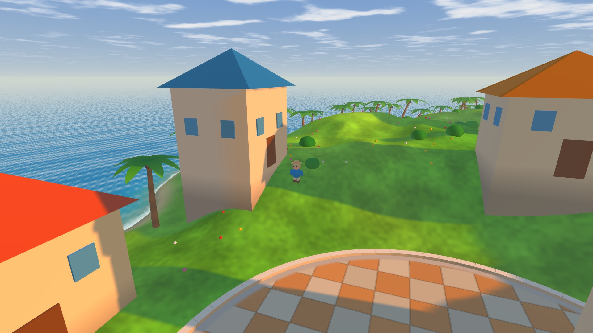
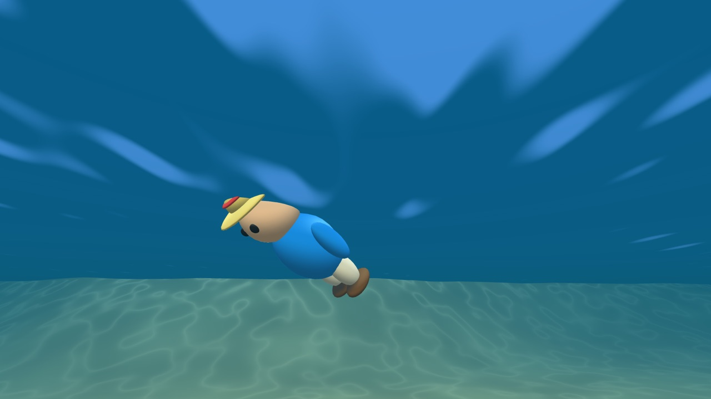

# OpenWorld

A native macOS third-person island prototype in a bright, stylized, low-poly tropical style. Swift and Metal, no engine, no asset files — the terrain, water, props and character are all generated from code at launch.



## Download

Grab a build from the [releases page](https://github.com/DennisFaucher/OpenWorld/releases) — `OpenWorld-vX.Y-macos-arm64.zip`, unzip it and run `./OpenWorld`. macOS 14 or later on Apple Silicon.

The binary is unsigned, so macOS quarantines it on first launch. Right-click it and choose **Open** once, or clear the flag with `xattr -dr com.apple.quarantine ./OpenWorld`.

Or build it from source below.

## Requirements

- macOS 14 or later on Apple Silicon
- Swift 6 toolchain (Xcode 16, or the standalone Swift toolchain)

## Build and run

```bash
swift build -c release
swift run -c release
```

Always use `-c release`. Terrain and prop generation evaluates a few hundred thousand noise samples at launch and is very slow in a debug build.

## Controls

| Input | Action |
| --- | --- |
| `W` `A` `S` `D` | Move, relative to the camera |
| `Shift` | Sprint |
| `Space` | Jump |
| Mouse | Orbit the camera (click the window first to capture the cursor) |
| Left mouse / `F` | Hold to fire the water jet (after the cursor is captured) |
| Aim down + fire | Lift off on the jet — about three seconds of lift, or fourteen of washing, before the pack runs dry |
| `E` | Board the boat you are standing beside, or step off the one you are in |
| Arrow keys | Orbit the camera |
| `R` | Respawn |
| `Esc` | Release the captured cursor |

Gamepad: left stick moves (or throttles and steers a boat), right stick orbits, right trigger sprints, `A` jumps, `B` boards and steps off. The jet is mouse or `F` only for now.

The ring in the middle of the screen is where the jet will land; the bar bottom-left is the water left in the pack, with the session's steps, miles and calories beside it.

Swimming out into open water and pitching the camera down dips it below the surface.

## Headless rendering

The game can render a single frame to a PNG without opening a window, which is how the visuals were checked during development:

```bash
.build/release/OpenWorld --shot shots/beach.png --pos -50 40 --yaw 1.9 --pitch 0.10 --dist 9
```

| Flag | Meaning |
| --- | --- |
| `--shot PATH` | Render one frame to `PATH` and exit |
| `--pos X Z` | Place the player on the terrain at `X, Z`. Also a spawn override for the live window, so a play-test does not start with a run across the island |
| `--yaw RAD` | Camera orbit angle (`0` puts the camera on `+Z`, `pi` is the spawn view); pairs with `--pos` in the live window |
| `--pitch RAD` | Camera elevation |
| `--dist D` | Camera distance |
| `--time T` | Animation clock, for the water and clouds |
| `--hour H` | Time of day, `0`–`24`; `12` (the default) is the original key light |
| `--walk` | Hold forward for the simulated frames, so wakes and splashes can be checked |
| `--spray` | Hold the water jet for the simulated frames |
| `--spray-frames N` | Fire for the first `N` frames and then let go, so the wet patches can be seen drying |
| `--frames N` | Number of simulation steps before the frame, default `90`; use it to catch a splash mid-air |
| `--sim N` | Skip rendering and print the player state (position, velocity, grounded, swimming, FOV, terrain slope, current pose) for `N` frames — how jump timing and the stride were measured |
| `--jump F D` | Press jump at frame `F` and hold it for `D` frames, with `--sim` or `--shot`. Repeat the flag for several presses |
| `--look RAD` | With `--shot`: orbit the finished frame by `RAD` without re-simulating, for a side view of a run cycle |
| `--stats` | With `--shot`: print how many terrain chunks and triangles the scene pass actually drew |
| `--slope-scan` | Print a histogram of the terrain gradient — how the 45° walkable limit was picked |
| `--size W H` | Output resolution, default 1920x1080 |

It runs 90 simulation steps first so physics and the camera settle, then renders one 4x-MSAA frame offscreen.

`.build/release/OpenWorld --version` prints the version.

## What's in it

- **An archipelago.** Four islands spread over 680 m of open water — the home island with the plaza, the mountain and the bell tower, plus three smaller cays with their own beaches, palms and summits. You can swim between them (about twenty seconds of open water to the nearest). One analytic height function (`World.height`) is a max over the islands, so a point is land if any island reaches it; a point far outside every coastline short-circuits to the sea floor before the noise is evaluated.
- **Terrain.** Each island is its own 1 m square patch, cut into 16 m chunks that are frustum-culled individually (about a quarter of it is drawn from the plaza). A flat sea-floor sheet fills the open water with the island patches cut out of it, so nothing is coplanar. Sand, grass and rock are blended per vertex by height and slope, with fragment-space detail layered underneath that fades out before it can alias.
- **Spray pack.** Hold the trigger and the character raises a nozzle and fires a water jet: a ballistic stream that lands exactly where the middle of the screen is pointing, cut off at the impact, with a splash and a wet patch that dries over a few seconds. The body turns to the jet while the legs keep walking.
- **Aiming and water.** A small ring in the middle of the screen marks where the jet will hit, and a gauge in the corner shows the tank, which turns amber when it is nearly out. The pack holds about fourteen seconds of washing or three seconds of lift, and refills when you swim or wade.
- **Activity readout.** Beside the tank gauge: footfalls, miles covered on foot and a rough calorie count, in a small pixel-font widget. The step count rides the same walk phase that fires the footfall dust, so it cannot drift from the animation, and swimming or a boat ride counts as travel but not as steps. The font is a 5x6 bitmap built into the composite shader — no text geometry, no font file, no extra pass.
- **Hover and washing.** Aim the jet at your feet and the thrust lifts you, at a steady climb that lasts as long as the tank does (the tank on the character's back shrinks as it empties). Twelve splats of goo are stuck to the plaza and the paths; a jet on one wears it away and tints the splash.
- **Boats and piers.** Every island has a plank jetty from the sand out past the drop-off, sited automatically from the coastline, and a boat moored at the end. Stand on the pier, press `E` beside the boat and steer with the same keys you run with: it accelerates to 12 m/s, leans into turns and refuses to run aground, so a cay is ten seconds away instead of a twenty-second swim. `E` again steps you off into the water.
- **Water clipmap.** Nine rings of 64x64 cells, 1 m at the camera doubling to 256 m, snapped to a single metre-aligned origin so the vertices sit at fixed world positions — the surface does not slide as you walk, which a camera-centred grid always did. 57k triangles instead of 180k.
- **Water.** A camera-centred radial grid with summed travelling waves, depth-based shallow/deep colour read from a height texture, Fresnel sky reflection, sun glitter, refracted shoreline, and animated foam along the shore. Swimming and wading leave foam and spray behind.
- **Ground contact.** Every footfall kicks up dust tinted by the ground it came off — sand, dry grass or rock — plus a wider cloud on landing, a skid trail while sliding, and a scuff when you push into a face too steep to climb.
- **Underwater.** Absorption fog, caustics on submerged surfaces, and the surface seen from below with the Snell window and total internal reflection.
- **Sky and time of day.** One cloud layer at a fixed altitude, drawn both by the sky (where the view ray meets it) and by shading (projected along the sun), so drifting cloud shadows cross the island under the clouds that cast them. `--hour` swings the sun across the sky, warming and dimming as it drops.
- **Props.** Palms, bushes, flowers, houses and a tower, all built from the same handful of mesh primitives, with collision shapes for the camera and the player.
- **Character.** An original design assembled from sphere primitives, rigged two segments per limb, with idle, run, jump, fall, swim and slide poses. States are weight-blended, so a jump eases out of the run instead of snapping.
- **Movement.** Variable jump height with coyote time and input buffering, sprinting, wading and swimming. Ground steeper than 45° can't be walked up — the player slides down the fall line instead, whatever the stick says.
- **Lighting.** A 4096x4096 directional shadow map with hardware PCF, hemispheric ambient with a baked contact shadow where walls meet the ground, plus HDR rendering with bloom and a highlight-only tone curve.
- **Instanced props.** Palms, bushes and flowers are 944 instances drawn from four small base meshes (three palm shapes and a unit sphere), batched into 40 m blocks and frustum-tested like terrain chunks: 41 of 115 batches and 357 of 944 instances are submitted from the plaza. Palms were one merged static mesh before, pushed to the GPU in full in both the main and the shadow pass from anywhere in the world.
- **Camera.** Orbit with collision against terrain and props.















## Layout

All code lives in `Sources/OpenWorld/`:

| File | Responsibility |
| --- | --- |
| `main.swift` | Entry point; `--shot` headless mode, otherwise starts `NSApplication` |
| `AppDelegate.swift` | Window, menu, and the `MTKView` that turns key/mouse events into input state |
| `Game.swift` | Player physics, swimming, obstacle push-out, orbit camera with collision, gamepad |
| `Particles.swift` | CPU particle pool for wakes, splashes, footfall dust, skids and jet spray |
| `Spray.swift` | The water jet: aim, the solved ballistic arc, wet patches and the goo splats |
| `World.swift` | Terrain height and normals, terrain mesh, height texture, props, obstacles |
| `MeshBuilder.swift` | CPU mesh primitives: quad, box, pyramid, frustum, sphere, palm |
| `Renderer.swift` | Metal setup, render passes, bloom chain, headless PNG output |
| `Player.swift` | Character rig: proportions, per-state poses, weight blending, sphere parts |
| `Shaders.swift` | All Metal Shading Language, compiled at launch |
| `MathUtil.swift` | Vector/matrix helpers |

`PROJECT_PLAN.md` tracks milestones and known rough edges; `AGENTS.md` documents the architecture in more detail, including the parts that are easy to break.

## Status

Playable prototype, `v2.0`. Two milestones are complete. **Look and feel:** terrain detail, water, shadows, bloom, the underwater view, drifting cloud shadows, time of day. **Character and movement:** variable jump height with coyote time and buffering, camera look-ahead and recentring, a measured 45° walkable limit with sliding, a rigged character with six weight-blended states, and ground-contact particles. Next is the water-jet mechanic, then world content.

The repository is not a complete game — there is no goal, no saving, and no audio.

## Notes

All art is generated in code. Nothing is ripped, imported, or derived from another game.
